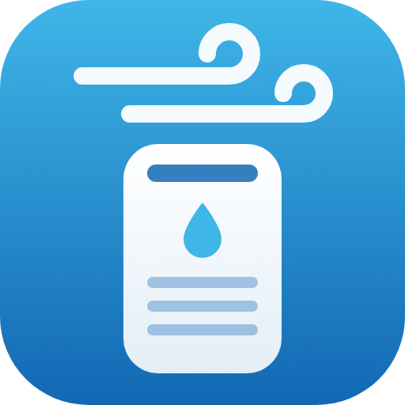

<p align="center">
  
</p>

<h1 align="center">Homebridge Daikin Air Purifier</h1>

<p align="center">
  Bring your Daikin air purifier into Apple Home: see the air in your room and control the purifier from your iPhone, Siri and automations.<br>
  <a href="#get-started"><b>⬇︎ Install the plugin</b></a>
  · Free · Built for the Daikin MCK70W · Tested on firmware 3.17.0-g4 · Homebridge 2.x
</p>

<p align="center">
  <a href="https://github.com/homebridge/homebridge/wiki/Verified-Plugins"></a>
  <a href="https://www.npmjs.com/package/@dylannlaw/homebridge-daikin-air-purifier"></a>
  <a href="https://www.npmjs.com/package/@dylannlaw/homebridge-daikin-air-purifier"></a>
  <a href="https://github.com/dylannlaw/homebridge-daikin-air-purifier/actions/workflows/tests.yml"></a>
  <a href="https://codecov.io/gh/dylannlaw/homebridge-daikin-air-purifier"></a>
  <a href="https://github.com/dylannlaw/homebridge-daikin-air-purifier/blob/master/LICENSE"></a>
  <a href="https://github.com/dylannlaw/homebridge-daikin-air-purifier"></a>
</p>

<p align="center">
  
</p>

> **Unofficial.** This is a community project. It isn't made, endorsed or supported by Daikin, and cloud mode uses the Daikin Smart App's service in a way Daikin hasn't approved. Read the [Disclaimer](#disclaimer) before you use cloud mode.

## Contents

- [What it can do](#what-it-can-do)
- [Before you start](#before-you-start)
- [Get started](#get-started)
- [Configure it](#configure-it)
- [Using it in the Home app](#using-it-in-the-home-app)
- [Limitations](#limitations)
- [Good to know](#good-to-know)
- [Disclaimer](#disclaimer)
- [More documentation](#more-documentation)
- [Contributing and releases](#contributing-and-releases)

## What it can do

<table>
  <tr>
    <td width="50%" valign="top">
      <h3>🌡️ See the air in your room</h3>
      Temperature, humidity and air quality (PM2.5, dust and odour) show up as sensors in the Home app, ready for automations like "turn the purifier on when air quality drops".
    </td>
    <td width="50%" valign="top">
      <h3>📊 Live purifier status</h3>
      Whether it's on, its mode, fan speed and humidifier are kept up to date, read straight from the purifier on your network or from the Daikin cloud.
    </td>
  </tr>
  <tr>
    <td width="50%" valign="top">
      <h3>🎛️ Control from HomeKit and Siri</h3>
      Turn it on or off, change the fan speed and switch the humidifier from the Home app, Siri, Control Center or a scene. Needs <a href="#cloud-mode-status-and-control">cloud mode</a>.
    </td>
    <td width="50%" valign="top">
      <h3>🍃 Eco, Pollen and Circulator modes</h3>
      Daikin's own modes each get a switch next to the purifier, so you can pick one with a tap. See <a href="#mode-switches">Mode switches</a>.
    </td>
  </tr>
  <tr>
    <td width="50%" valign="top">
      <h3>⚡ Local first, cloud fallback</h3>
      Add the purifier's local IP and status is read straight from it, in well under a second. The Daikin cloud takes over whenever the purifier can't be reached.
    </td>
    <td width="50%" valign="top">
      <h3>🛡️ Gentle on your Daikin account</h3>
      Signs in by itself, reuses its tokens, caches status and backs off when Daikin says slow down, so your account isn't rate-limited or locked. See <a href="#how-often-it-checks-and-rate-limits">rate limits</a>.
    </td>
  </tr>
</table>

## Before you start

You need:

1. **A Daikin air purifier** on your Wi-Fi and set up in the [Daikin Smart App](https://apps.apple.com/app/id564109247). The plugin is built and tested with the **MCK70W** on firmware **3.17.0-g4**. To see your purifier's firmware, open the purifier in the Daikin Smart App and go to its **Model information** section.
2. **Homebridge** 2.0 or later running on Node.js 22, 24 or 26 (Node.js 26 needs Homebridge 2.3 or later). New to Homebridge? Start with the [Homebridge install guide](https://github.com/homebridge/homebridge/wiki).
3. **Then pick what you want** (you can change it later):

| You want | Mode | You'll need |
|---|---|---|
| Sensors, status **and control** from HomeKit | **Cloud mode** | Your Daikin Smart App email and password, plus a `clientSecret` and `terminalId` captured once from the app |
| Sensors and status only (read-only) | **Local mode** | The purifier's local IP address, shown in the Daikin Smart App under **Model information** |

## Get started

1. **Install the plugin.** In the Homebridge UI, open **Plugins**, search for **Homebridge Daikin Air Purifier** and click **Install**. Or, from the command line:

   ```sh
   npm install -g @dylannlaw/homebridge-daikin-air-purifier
   ```

2. **Find the purifier's local IP address.** In the Daikin Smart App, open the purifier and go to its **Model information** section: the IP address is listed there. Local mode needs it, and in cloud mode it makes status much faster (see below).
3. **Give the purifier a fixed IP** (recommended). In your router, reserve that IP address for the purifier so it doesn't change.
4. **Configure it.** Open the plugin's **Settings** in the Homebridge UI and fill in the fields for your mode, or edit `config.json` as shown in [Configure it](#configure-it).
5. **Restart Homebridge.** The purifier and its sensors appear in the Home app, in the room of your Homebridge bridge. Move them to the right room if you like.
6. **Check the log.** If control is off, the log says `Running in read-only mode` and names the missing settings, for example `Control is off because these settings are missing: terminalId.`

## Configure it

The plugin's block goes in the `platforms` list of your Homebridge `config.json` (the Homebridge UI puts it there for you). Without a local IP or a Daikin login, the plugin logs a warning and doesn't start.

> **Upgrading from 2.0 or earlier?** Version 2.1 is a Homebridge platform plugin instead of an accessory plugin. Move the purifier's block from `accessories` to `platforms` and rename its `"accessory"` key to `"platform"`. Every other setting stays the same. The Home app sees it as a new accessory, so put it back in its room and redo any scenes and automations. If you skip this, Homebridge logs `No plugin was found for the accessory "DaikinAirPurifier"`, and the plugin logs these same steps just before it. If you have both blocks, the plugin warns you to delete the old one.

### Cloud mode (status and control)

All four of `username`, `password`, `clientSecret` and `terminalId` are required. If any one is missing, the purifier still shows in the Home app but is **read-only**: you can see its status, but not turn it on or off or change the fan speed or humidifier.

1. Enter the **email** and **password** you sign in to the Daikin Smart App with.
2. Capture `clientSecret` and `terminalId` once from the app's traffic: [Capturing credentials with mitmproxy](https://github.com/dylannlaw/homebridge-daikin-air-purifier/blob/master/docs/guides/capturing-credentials.md) shows how. After that, the plugin logs in by itself. Daikin hasn't approved this. Read the [Disclaimer](#disclaimer) first.
3. **Recommended: add `host`, the purifier's local IP.** Status is then read straight from the purifier on your network, which answers in well under a second. Without it, every status read goes through the Daikin cloud, which waits for the purifier to check in and can take several seconds or time out. The cloud is still used for control (current firmware has no local control) and as the fallback when the purifier can't be reached locally. Give the purifier a fixed IP in your router so it doesn't change.

```json
{
    "platform": "DaikinAirPurifier",
    "name": "DaikinAirPurifier",
    "cacheDuration": 60,
    "host": "192.168.1.1",
    "username": "you@example.com",
    "password": "your Daikin Smart App password",
    "clientSecret": "captured once from the app",
    "terminalId": "captured once from the app"
}
```

### Local mode (status only)

Only `host`, the purifier's local IP, is required. Leave the Daikin account settings empty.

```json
{
    "platform": "DaikinAirPurifier",
    "name": "DaikinAirPurifier",
    "cacheDuration": 60,
    "host": "192.168.1.1"
}
```

### All settings

| Setting | Needed for | Description |
|---|---|---|
| `host` | **Required in local mode**; **recommended in cloud mode** | Status is read from this IP first, which is much faster than the Daikin cloud; in cloud mode the cloud is the fallback. The purifier's local IP address, shown in the Daikin Smart App under the purifier's **Model information**. Give it a fixed IP in your router so it doesn't change. |
| `cacheDuration` | Optional (default 60) | How often, in seconds, status is fetched. See [How often it checks, and rate limits](#how-often-it-checks-and-rate-limits). |
| `modeSwitches` | Optional (default all three) | Which Daikin modes get a switch in HomeKit: `eco`, `pollen`, `circulator`. `[]` shows none. See [Mode switches](#mode-switches). |
| `username`, `password` | **Required for control**; also cloud status | The email and password you sign in to the [Daikin Smart App](https://apps.apple.com/app/id564109247) with. |
| `clientSecret` | **Required for control**; also cloud status | The `client_secret` in the body of the app's `https://prod-dsioti.daikinsmartdb.jp/dsioti/oauth2/token` request. |
| `terminalId` | **Required for control** | The `terminalid` query parameter of the app's `https://api.daikinsmartdb.jp/cleaner/set_control_info` request, sent when you change a setting in the app. Cloud status works without it. |
| `port` | Optional, cloud mode only | Leave empty: the plugin reads it from the purifier (`port=` at `http://<purifier IP>/common/basic_info`), or uses `30050` when there's no `host`. Not used in local mode. |

Advanced settings (`clientId`, `uuid`, `code`, `refreshToken`) are described in [How it works](https://github.com/dylannlaw/homebridge-daikin-air-purifier/blob/master/docs/guides/how-it-works.md#advanced-settings). Leave them empty unless you need them.

## Using it in the Home app

- **The purifier tile** turns the purifier on or off. Open it to set the fan speed and switch between Auto and Manual.
- **The humidifier** has its own tile, shown with the purifier, to turn humidifying on or off (cloud mode).
- **Sensors** for temperature, humidity and air quality appear alongside it and can trigger automations.

### Mode switches

HomeKit's Air Purifier only has Auto and Manual, so Daikin's Eco, Pollen and Circulator modes each get a switch, shown with the purifier in the Home app. On a Japanese purifier, these are courses you pick with the コース button:

| Switch in HomeKit | Label on the purifier | What it does |
|---|---|---|
| Eco | 節電 (setsuden, "power saving") | Runs quietly at a low fan speed to save power, and speeds up when the air gets dirty. |
| Pollen | 花粉 (kafun, "pollen") | Pulses the airflow gently so pollen drops to the floor and is drawn into the filter. |
| Circulator | サーキュレーター (circulator) | Strong airflow that moves air around the room like a fan while it cleans. |

HomeKit's **Auto** is the purifier's おまかせ (omakase, "leave it to me") button. Only the switch for the current mode is on:

- Turning one on puts the purifier in that mode (turning it on if it's off) and turns the others off. In these modes the purifier picks its own fan speed.
- Turning off the current mode's switch puts the purifier back in Auto.
- Moving the fan speed slider switches to manual fan speed, so the mode switches turn off.

Each change is one request, like any other control. In local mode, or without the control settings, the switches only show the current mode. Use `modeSwitches` to choose which switches appear.

## Limitations

- **No local control.** Newer purifier firmware (for example `3_15_0`) has removed local control, so control always goes through the Daikin cloud, the same way the Daikin Smart App does. Local mode is read-only.
- **Cloud status and control are new** and not yet confirmed working end to end. The login follows the Daikin Smart App's current login. If it fails, the log says why. With `host` set, status keeps coming from the purifier anyway.
- **One model and firmware tested.** Only the MCK70W on firmware 3.17.0-g4 has been tested. Other firmware versions and other Daikin purifiers that use the Daikin Smart App may work, but aren't confirmed.

## Good to know

### How often it checks, and rate limits

Every refresh is one request: to the purifier on your network when `host` is set, otherwise to the Daikin cloud. HomeKit reads in between are answered from the last result.

- **Local IP:** minimum 15 seconds. There's no account limit, but very frequent polling can make the purifier slow to respond. If the purifier doesn't answer and your Daikin account is set, status is read from the cloud instead, at most once a minute.
- **Daikin cloud only (no `host`):** minimum 60 seconds. **Refreshing too often can get your Daikin account rate-limited** (HTTP 429). When that happens the plugin pauses all cloud requests, including control, for 5 minutes. At 60 seconds that's 1,440 cloud requests a day; 300 seconds (5 minutes) is 288. Setting `host` avoids these requests altogether.

A value below the minimum is raised to it, with a warning in the log.

### Your account and privacy

- Your Daikin email, password, `clientSecret` and `terminalId` stay in your Homebridge config and are never written to the log.
- Status comes from `https://api.daikinsmartdb.jp`, the same Daikin service the app uses. Without an account, nothing leaves your network.
- Found a security problem? Please report it privately, as described in the [Security policy](https://github.com/dylannlaw/homebridge-daikin-air-purifier/blob/master/SECURITY.md).

## Disclaimer

- **Not affiliated with Daikin.** This plugin is an independent community project. It isn't made, endorsed, supported or reviewed by Daikin Industries, Ltd. "Daikin" and Daikin product names are trademarks of their owner. This README uses them only to say which purifiers the plugin works with.
- **Cloud mode uses an unofficial API.** Daikin doesn't publish an API for the Daikin Smart App. Cloud mode talks to the service the app uses, in the same way the app does, with `clientSecret` and `terminalId` values you capture from the app yourself. Daikin hasn't approved this, and it may go against the terms you accepted for the Daikin Smart App and CLUB DAIKIN. Read those terms before you turn cloud mode on. You'll find the app's licence agreement (利用許諾書) in the app's settings.
- **Your Daikin account is at your own risk.** Daikin can change or block this API at any time, and may limit, suspend or close an account it sees used this way. The plugin keeps cloud requests low (see [rate limits](#how-often-it-checks-and-rate-limits)), but it can't guarantee your account won't be affected.
- **Local mode doesn't use Daikin's cloud.** It reads status only from the purifier on your own network, and needs no Daikin account. If you'd rather not use Daikin's service this way, use local mode, which is read-only.
- **No warranty.** The plugin is provided "as is", without warranties or conditions of any kind, under the [Apache License 2.0](https://github.com/dylannlaw/homebridge-daikin-air-purifier/blob/master/LICENSE). The authors aren't liable for any damage, loss or account action that comes from using it (see sections 7 and 8 of the licence).
- **From Daikin?** If you'd like something changed or removed, please [open an issue](https://github.com/dylannlaw/homebridge-daikin-air-purifier/issues) and we'll respond.

## More documentation

| Guide | Read it to |
|---|---|
| 📖 [How it works](https://github.com/dylannlaw/homebridge-daikin-air-purifier/blob/master/docs/guides/how-it-works.md) | Understand how status is read (local IP first, cloud as fallback), how control works end to end, how the plugin logs in and stores tokens, how it keeps API calls low, the advanced settings, and the API reference. |
| 🔑 [Capturing credentials with mitmproxy](https://github.com/dylannlaw/homebridge-daikin-air-purifier/blob/master/docs/guides/capturing-credentials.md) | Read `clientSecret` and `terminalId` from the Daikin Smart App's traffic, step by step, and what to do if the app refuses the connection. |
| 📱 [Testing locally with your iPhone](https://github.com/dylannlaw/homebridge-daikin-air-purifier/blob/master/docs/guides/testing-locally.md) | Try the plugin, or a change that isn't released yet, in a private test Homebridge on your computer and the Home app on your iPhone, with one command. |
| 🛡️ [Security policy](https://github.com/dylannlaw/homebridge-daikin-air-purifier/blob/master/SECURITY.md) | Report a security problem privately. |
| 🗂️ [Project docs index](https://github.com/dylannlaw/homebridge-daikin-air-purifier/blob/master/docs/README.md) | Browse the plans, change notes and research behind every change. |

## Contributing and releases

Ideas and fixes are welcome. The [contributing guide](https://github.com/dylannlaw/homebridge-daikin-air-purifier/blob/master/CONTRIBUTING.md) shows how to help, even without writing code.

Every change to the plugin is released to npm as soon as it is merged. See the [CHANGELOG](https://github.com/dylannlaw/homebridge-daikin-air-purifier/blob/master/CHANGELOG.md) or [Releases](https://github.com/dylannlaw/homebridge-daikin-air-purifier/releases) for what changed in each version.
